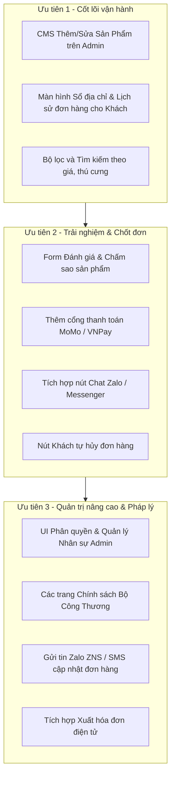

# Đánh giá các tính năng còn thiếu để hoàn thiện Website Thương Mại Điện Tử

> **Dự án**: Petshop E-Commerce System (FastAPI + Next.js 15)  
> **Mục tiêu**: Bổ sung lộ trình hoàn thiện các tính năng để hệ thống sẵn sàng vận hành thực tế (Production-ready).

---

## 1. Phía Khách Hàng (Storefront) — Trải Nghiệm Mua Sắm

| Phân hệ / Chức năng | Hiện trạng dự án | Các tính năng còn thiếu cần bổ sung |
| :--- | :--- | :--- |
| **Đánh giá & Nhận xét (Reviews)** | Đã có bảng CSDL `reviews` và API Admin duyệt bài. | • Form cho khách viết đánh giá, chấm sao (1–5⭐) sau khi nhận đơn hàng thành công. • Cho phép tải lên hình ảnh/video thực tế của sản phẩm. • Phân loại: Có ảnh, theo số sao, đã mua hàng (Verified Purchase). |
| **Trung tâm tài khoản (Customer Dashboard)** | Mới có Đăng ký, Đăng nhập cơ bản. | • Quản lý hồ sơ cá nhân, đổi mật khẩu. • **Sổ địa chỉ giao hàng (`customer_addresses`)**: Thêm, sửa, xoá, chọn địa chỉ mặc định. • **Lịch sử đơn hàng cá nhân**: Xem danh sách đơn đã mua, chi tiết đơn, trạng thái thanh toán và hành trình vận chuyển. |
| **Tìm kiếm & Bộ lọc nâng cao (Search & Filters)** | Xem theo danh mục tĩnh. | • Thanh tìm kiếm gợi ý nhanh từ khoá (Auto-complete / Instant search). • **Bộ lọc kết hợp (Faceted Filter)**: Lọc theo tầm giá, thương hiệu, loại thú cưng (chó/mèo), độ tuổi, trọng lượng. • **Sắp xếp**: Mới nhất, Bán chạy nhất, Giá tăng/giảm. |
| **Hủy đơn & Đổi trả (Returns & Cancellation)** | Chỉ Admin mới thao tác đổi trạng thái đơn. | • Nút cho khách tự bấm **"Hủy đơn hàng"** khi đơn còn ở trạng thái `pending` hoặc `confirmed`. • Luồng gửi yêu cầu **Đổi trả / Hoàn tiền** nếu sản phẩm lỗi, hỏng hoặc giao sai. |
| **Danh sách yêu thích (Wishlist)** | Chưa có. | • Cho phép khách lưu các sản phẩm yêu thích vào Wishlist để mua sau. • Gợi ý thông báo khi sản phẩm trong danh sách yêu thích giảm giá. |
| **Cổng thanh toán đa dạng** | Đã có COD và VietQR động (payOS). | • Tích hợp các ví điện tử phổ biến tại Việt Nam: **MoMo, VNPay, ZaloPay**. • Cổng thanh toán thẻ quốc tế Visa / Mastercard. |

---

## 2. Phía Quản Trị (Admin / Back-office) — Vận Hành Cửa Hàng

| Phân hệ Admin | Hiện trạng dự án | Các tính năng còn thiếu cần bổ sung |
| :--- | :--- | :--- |
| **Quản lý Nhân sự & Phân quyền (RBAC UI)** | Phân quyền cứng trong code, cấp quyền thủ công qua câu lệnh SQL. | • Giao diện thêm mới nhân viên, đặt mật khẩu ban đầu. • Phân bổ vai trò trực quan: `owner`, `warehouse_staff`, `cskh_staff`. • Khoá/mở khoá tài khoản, cấp lại mã QR 2FA TOTP khi đổi thiết bị. |
| **Quản lý Sản phẩm & Danh mục (Catalog CMS)** | Đã có API Backend, nhưng thêm sản phẩm phải dùng script/cURL. | • Màn hình Admin tạo mới / chỉnh sửa Sản phẩm và các Biến thể (SKU, giá, cân nặng, mô tả chi tiết). • Công cụ tải lên ảnh sản phẩm (kéo thả ảnh, nén ảnh tự động và xóa dữ liệu EXIF trước khi lưu). |
| **Quản lý Khách hàng (CRM)** | Chưa có giao diện. | • Danh sách khách hàng đã đăng ký, tìm kiếm theo Tên / SĐT / Email. • Xem lịch sử mua sắm, giá trị vòng đời khách hàng (LTV). • Ghi chú nội bộ (`staff_note`), gắn cờ cảnh báo khách bom hàng / spam. |
| **Quản lý Nội dung & Khuyến mãi (Marketing CMS)** | Đã có quản lý mã giảm giá (Promotions). | • Giao diện thay đổi Banner quảng cáo, Slider ưu đãi tại trang chủ. • Quản trị Blog / Cẩm nang chăm sóc thú cưng để phục vụ SEO. |

---

## 3. Tương Tác & Chăm Sóc Khách Hàng (Support & Automation)

1. **Thông báo đơn hàng tự động (Omnichannel Alerts)**:
   * Hiện tại mới có email xác nhận đơn hàng sau khi đặt.
   * *Cần thêm:* Gửi email / SMS / Zalo ZNS tự động tại các mốc: *Đang đóng gói*, *Đã bàn giao bưu cục*, *Đang giao hàng*, *Giao thành công*.
2. **Kênh liên hệ trực tiếp (Live Chat)**:
   * Nút chat nhanh tích hợp **Zalo OA** hoặc **Facebook Messenger** ở góc màn hình.
   * AI Chatbot tư vấn cẩm nang dinh dưỡng và gợi ý sản phẩm tự động (tận dụng `pgvector` có sẵn trong database).
3. **Thu hồi giỏ hàng bỏ quên (Abandoned Cart Recovery)**:
   * Tự động gửi email/thông báo nhắc nhở sau 24h nếu khách đã thêm hàng vào giỏ nhưng chưa hoàn tất đặt hàng.

---

## 4. Pháp Lý & Vận Hành Chuẩn TMĐT Tại Việt Nam

1. **Bộ chính sách bắt buộc**:
   * *Điều khoản dịch vụ* & *Chính sách bảo vệ dữ liệu cá nhân (Nghị định 13/2023/NĐ-CP)*.
   * *Chính sách giao hàng, kiểm hàng, đổi trả và hoàn tiền*.
2. **Khai báo Bộ Công Thương**:
   * Khai báo website TMĐT bán hàng tại cổng `online.gov.vn` để được gắn logo xanh/đỏ (tránh rủi ro xử phạt hành chính).
3. **Hóa đơn điện tử (e-Invoice)**:
   * Tích hợp giải pháp xuất hóa đơn điện tử tự động (theo Nghị định 123/2020) cho khách hàng có nhu cầu lấy VAT công ty.

---

## 5. Lộ Trình Triển Khai Đề Xuất (Theo Mức Độ Ưu Tiên)

