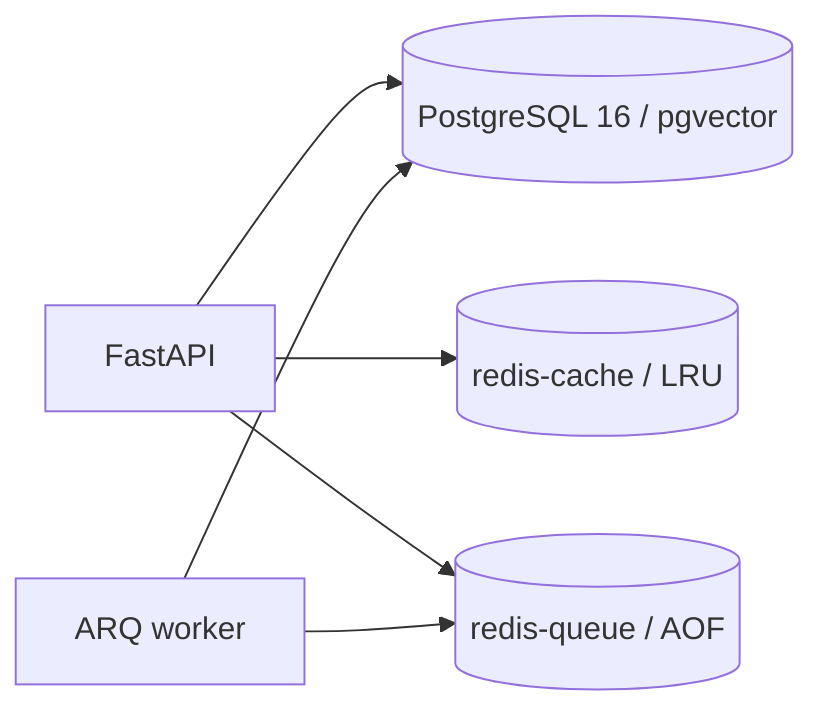
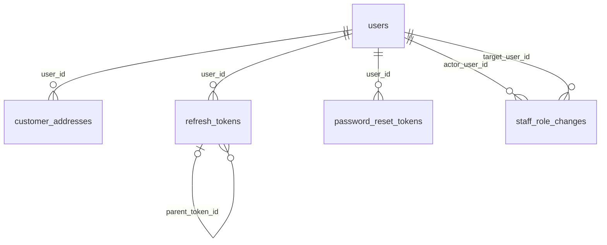
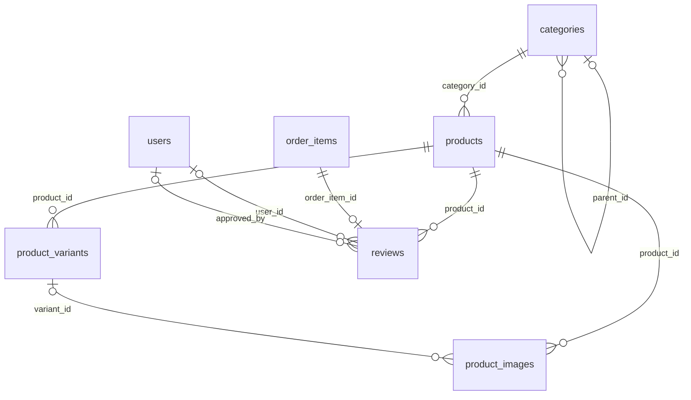
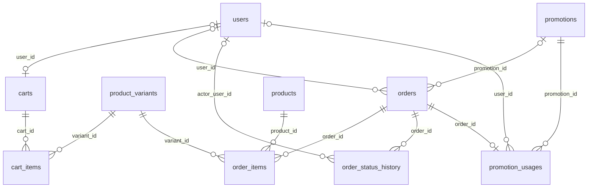
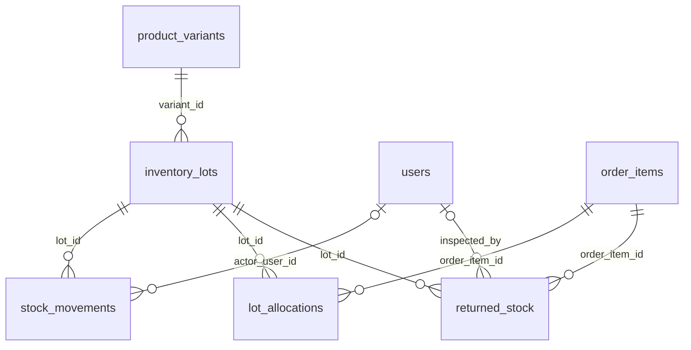
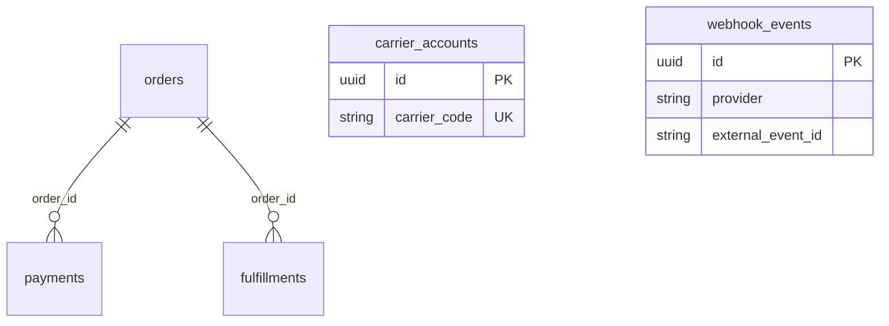
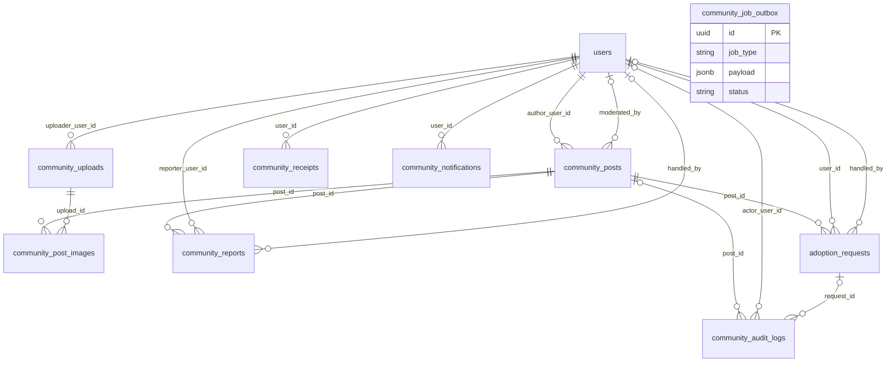
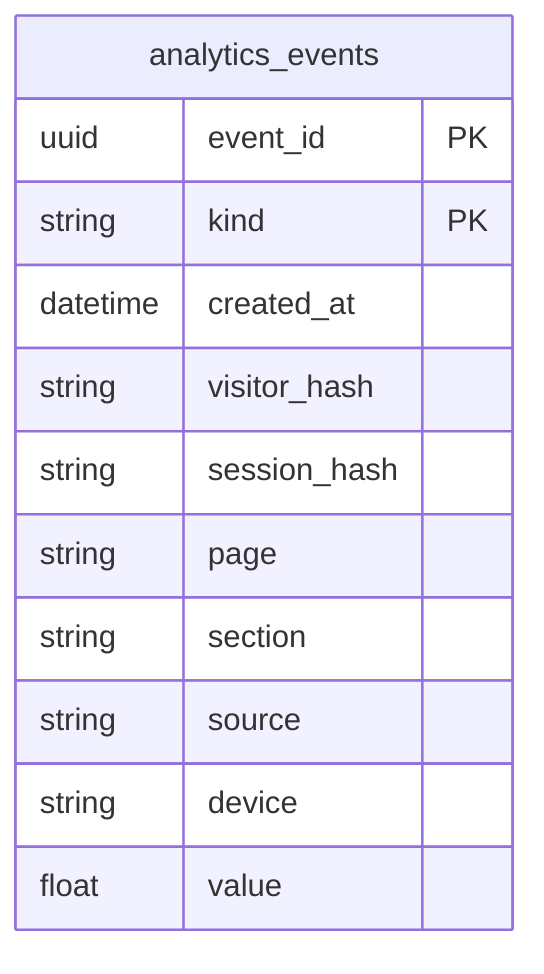

# Sơ đồ database PetHome

Nguồn: backend/app/models/*.py, migration đến 0008, docker-compose.yml. Schema theo mã nguồn; chưa xác nhận database đang chạy do không truy cập được Docker.

35 bảng nghiệp vụ PostgreSQL và 2 Redis (không tính alembic_version).

## Hệ thống lưu trữ

## Tài khoản: 5 bảng

## Sản phẩm: 5 bảng

## Bán hàng: 7 bảng

## Kho: 4 bảng

## Thanh toán và giao hàng: 4 bảng

carrier_accounts và fulfillments cùng có carrier_code nhưng không khai báo FK giữa chúng. webhook_events không có FK.

## Cộng đồng và cứu hộ: 9 bảng

community_job_outbox không có FK. community_receipts.resource_id là tham chiếu logic.

## Analytics: 1 bảng

Khóa chính ghép (event_id, kind); không có FK.

## Chú thích

- Đường nối là FK khai báo trong model. || = đúng một, o| hoặc |o = không hoặc một, o{ = không hoặc nhiều.
- Bảng ngoài nhóm được lặp lại để thấy quan hệ liên nhóm.
- Tập trung vào bảng và quan hệ, không liệt kê đầy đủ cột, CHECK, index và unique có điều kiện.
- stock_movements.ref_id/ref_type và tham chiếu trong JSON không phải FK.
